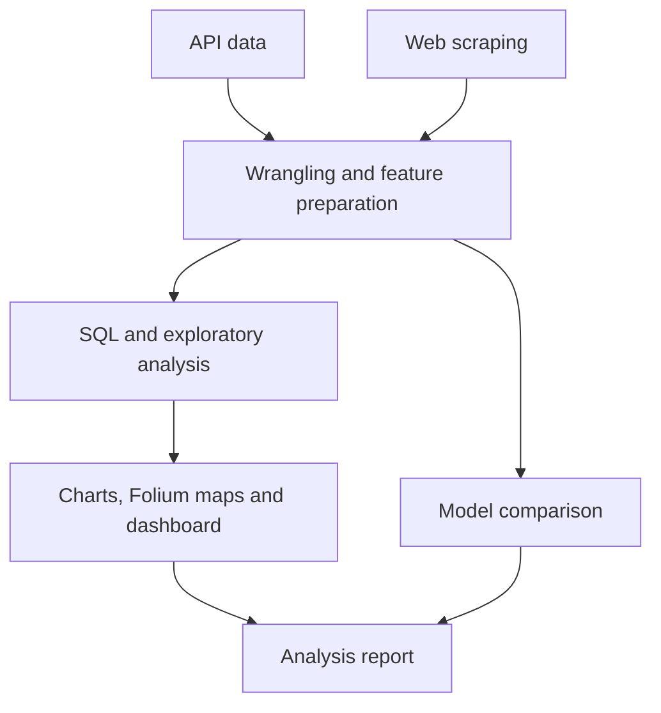

# 🚀 SpaceX Falcon 9 — First-Stage Landing Prediction

An **IBM Data Science capstone** connecting data acquisition, SQL exploration, geospatial visualization, and classical machine learning to analyze Falcon 9 booster landing outcomes.


[Overview](#-project-overview) · [Workflow](#-analysis-workflow) · [Quick start](#-quick-start) · [Dashboard](#-interactive-dashboard) · [Author](#-author)

---

## 🎯 Project overview

Booster recovery is an important part of reusable launch operations. This project investigates relationships between launch characteristics and first-stage landing success, then compares classification models for the binary outcome.

The project demonstrates a complete analytical workflow: collect and clean data, explore operational patterns, visualize launch locations, and communicate findings through notebooks, a dashboard, and a report.

## 🏆 Project highlights

- **Data acquisition:** API requests and web scraping.
- **Data preparation:** cleaning and feature preparation for landing classification.
- **SQL and visual exploration:** examine relationships between launch characteristics and outcomes.
- **Geospatial analysis:** Folium maps of launch locations.
- **Model comparison:** logistic regression, SVM, decision tree, and K-nearest neighbors with GridSearchCV.
- **Communication:** Plotly Dash dashboard and an included analysis report.

## 🏗️ Analysis workflow



## 📂 Explore the project

| Stage | Repository resource |
| --- | --- |
| API acquisition | [Data collection notebook](Data_collecting/data-collection-APIcall.ipynb) |
| Web scraping | [Scraping notebook](Data_collecting/Webscraping.ipynb) |
| Data preparation | [Wrangling notebook](EDA/Data%20wrangling.ipynb) |
| SQL exploration | [SQL notebook](EDA/EDA_sql.ipynb) |
| Visual analysis | [EDA visualization](Data_Visualization/EDA_Visualization.ipynb) |
| Launch-site mapping | [Folium notebook](Data_Visualization/Launch_site_location.ipynb) |
| Classification | [Model development notebook](Model_development/SpaceX_Machine%20Learning%20Prediction_Part_5.ipynb) |
| Dashboard | [Dash application](Data_Visualization/SpaceX_DashBoard.py) |
| Findings | [Analysis report](ReportOfTheAnalysis_SpaceX.pdf) |

## 🚀 Quick start

```bash
git clone https://github.com/IBOSS24/SpaceX_competitor_-.git
cd SpaceX_competitor_-
python -m venv .venv
```

Activate with `source .venv/bin/activate` on Linux/macOS or `.\.venv\Scripts\Activate.ps1` in Windows PowerShell, then install a starting set of dependencies:

```bash
python -m pip install pandas numpy scikit-learn matplotlib seaborn plotly dash folium requests beautifulsoup4 lxml sqlalchemy jupyter
python -m jupyter notebook
```

This repository does not currently include a pinned requirements file. Some notebooks retain IBM browser-notebook constructs such as `from js import fetch` and top-level `await`; those cells need adaptation to a local runtime, for example by loading the provided CSV URLs with `pandas.read_csv(url)`.

Follow the acquisition, preparation, exploration, and modeling stages in the table above. Review each notebook's input paths and external data dependencies before execution.

## 📊 Model comparison and evaluation

| Model | Approach explored |
| --- | --- |
| Logistic regression | Linear classification baseline |
| Support vector machine | Kernel and regularization search |
| Decision tree | Tree depth, splitting, and leaf-size search |
| K-nearest neighbors | Neighbor count and distance configuration |

The modeling notebook uses a train/test split and cross-validated parameter search. **A priority improvement is moving standardization inside a scikit-learn Pipeline:** the current notebook fits the scaler before the split, allowing test-set information into preprocessing. Model scores should be re-evaluated after correcting this.

Older parameter choices may also need updating for the installed scikit-learn version. This README presents the implemented workflow without asserting deployment-grade predictive performance.

## 🌐 Interactive dashboard

The Dash application provides a launch-site selector, success-count pie charts, a payload range slider, and a payload/outcome scatter plot colored by booster category.

It expects `spacex_launch_dash.csv` in the current working directory; that CSV is not included in the repository. Obtain the corresponding educational dataset before launching:

```bash
python Data_Visualization/SpaceX_DashBoard.py
```

Open the URL printed in the terminal. Required columns include `Launch Site`, `class`, `Payload Mass (kg)`, and `Booster Version Category`.

## 🧭 Connection to maritime analytics

This project develops transferable skills for maritime work: acquiring operational data, studying location-dependent outcomes, building geospatial views, and comparing predictive baselines. Future applications could include port traffic analysis and vessel arrival forecasting, with validation designed for their temporal structure.

## 🔭 Next steps

- Correct preprocessing leakage and rerun model comparison.
- Pin a reproducible environment and adapt notebook-specific runtime cells.
- Document dataset provenance and add data availability checks.
- Add per-class evaluation and uncertainty reporting.
- Package reusable acquisition and modeling functions.

## 🙏 Acknowledgments

Developed through the IBM Data Science capstone using educational SpaceX launch datasets and IBM Skills Network materials.

---

## 👨‍💻 Author

**Mohammed Badr**  
State-qualified engineer · Moroccan Royal Navy officer · Building a career in maritime Data Science & ML Engineering

I bring experience at sea and in maritime command centers to my work in applied machine learning. My focus is developing reliable ML systems and applying them to maritime traffic forecasting, vessel behavior analysis, and equipment reliability.

[](https://github.com/IBOSS24/Portfolio_) [](https://www.linkedin.com/in/mohammed-e-a13664182) [](https://mail.google.com/mail/?view=cm&fs=1&to=med.marin17%40gmail.com)
